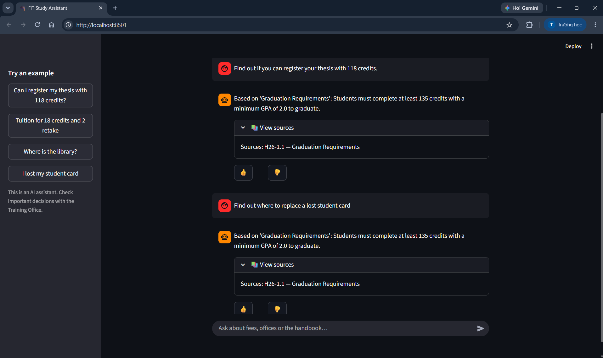
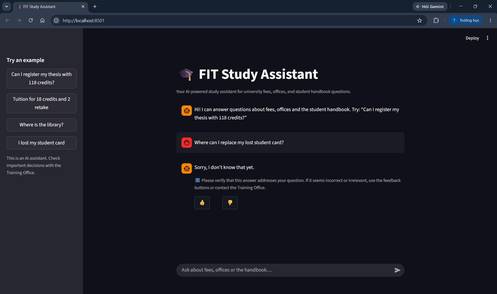

# Lab 7 Homework — 10-minute Usability Test

**Tester (first name only):** Minh
**Date:** 22/11/2026

**Task given:**

"Find out if you can register your thesis with 118 credits, and where to replace a lost student card."

## Observations

| # | What the tester did or said | What they expected | Why the system/UI caused it | Fix idea |
|---|---|---|---|---|
| 1 | Asked whether they could register their thesis with 118 credits. The assistant returned the graduation requirement of 135 credits and a minimum GPA of 2.0. | A direct answer explaining whether they were eligible to register for their thesis with 118 credits. | The assistant returned graduation requirements instead of the specific thesis registration requirement. | Improve answer relevance and provide a clear response to the user's actual question. |
| 2 | Asked where to replace a lost student card. The assistant returned the same graduation requirement information. | The name or location of the office responsible for replacing lost student cards. | The assistant retrieved or generated information unrelated to the question, while the UI displayed it as a normal answer. | Improve irrelevant-answer handling and provide a clear escalation message when the answer cannot be found. |
| 3 | Noticed that the assistant's response did not match the question. | An answer relevant to the question, or a clear indication that the assistant could not provide the information. | The UI displayed the response normally without a prominent warning that the information might be irrelevant. | Add a visible reminder to verify answers and use the feedback buttons when an answer is incorrect or irrelevant. |

## The one change we made

Added a visible information notice below the assistant's answer to remind users to verify answer relevance and report incorrect or irrelevant responses.

**Commit link:** [Insert GitHub commit URL]

## Before / After screenshot

- **Before:** 
- **After:** 

## H2 – Google PAIR Guidebook Reflection

**Idea used today:** I applied the principle of providing clear feedback by adding a visible reminder that encourages users to verify whether the assistant's answer addresses their question.

**One improvement I would add:** I would improve graceful failure by making irrelevant answers easier to report and providing clearer guidance on how users can contact the Training Office for assistance.
