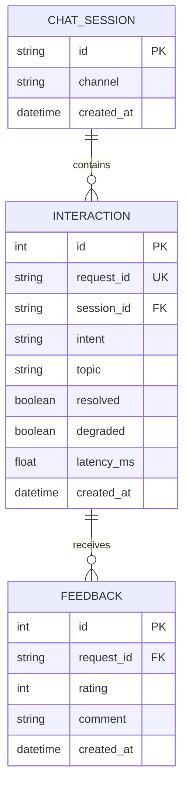

# Lab 5 — Data model worksheet

## 1. Critique the bad schema (sql/bad_schema.sql)

| # | Problem | Why it hurts | Fix |
|---|---|---|---|
| 1 | `id` has no PRIMARY KEY constraint. | Records may have duplicate or NULL identifiers. | Define `id INTEGER PRIMARY KEY`. |
| 2 | Stores `student_name`. | Unnecessary personal information increases privacy risks. | Do not collect or store student names. |
| 3 | Stores `student_phone`. | Phone numbers are personal data and are not required for analytics. | Do not collect or store phone numbers. |
| 4 | Stores full raw `message` forever. | Messages may contain sensitive information and create data leakage risks. | Store only necessary interaction metadata. |
| 5 | Stores full raw `answer`. | Full answer content is unnecessary for basic performance analytics. | Store metadata such as intent, topic and resolution status. |
| 6 | `intent` uses unrestricted free text. | Different spellings of the same intent lead to inconsistent statistics. | Normalize and validate intent categories. |
| 7 | `time` is stored as arbitrary TEXT. | Inconsistent formats make time-based queries and sorting unreliable. | Use a consistent datetime representation. |
| 8 | `feedback` and `latency` are stored as TEXT. | Feedback cannot be queried independently and latency cannot be reliably averaged. | Create a separate feedback table and store latency as numeric `latency_ms`. |

## 2. Store or not? (privacy-aware storage)
| Data | Store? | Form (raw / hashed / aggregated / none) | Retention | Reason |
|---|---|---|---|---|
| raw user message | No | none | Not retained | May contain personal or sensitive information. No feature requires storing the full message. |
| session id | Yes | hashed (SHA-256 + secret salt) | As long as needed for session analytics | Allows interactions from the same session to be grouped without storing the original session ID. |
| intent, latency, topic | Yes | raw structured metadata; aggregated for analytics | As long as needed for system improvement | Helps analyze common topics, measure response time and identify system performance issues. |
| feedback rating | Yes | raw (rating value) | As long as needed for feedback evaluation | Helps measure user satisfaction and answer quality. |
| feedback comment | Yes | raw (optional comment) | As long as needed for feedback evaluation | Provides additional context for understanding user feedback. |
| student name / phone | No | none | Not retained | No feature requires this personal information. Avoiding unnecessary collection reduces privacy risks. |

**Note on retention:** The Lab 5 tutorial does not specify exact retention periods. The system should define a retention policy and delete data when it is no longer needed. 

## 3. Product questions → fields
| Product question | Fields needed | Table(s) | Query sketch |
|---|---|---|---|
| Most failed intent? | intent, resolved | interaction | SELECT intent, COUNT(*) AS failures FROM interaction WHERE resolved = 0 GROUP BY intent ORDER BY failures DESC; |
| Average response time by intent? | intent, latency_ms | interaction | SELECT intent, ROUND(AVG(latency_ms), 1) AS avg_latency_ms FROM interaction GROUP BY intent ORDER BY avg_latency_ms DESC; |
| Top unresolved topics? | topic, resolved | interaction | SELECT topic, COUNT(*) AS unresolved_count FROM interaction WHERE resolved = 0 AND topic IS NOT NULL GROUP BY topic ORDER BY unresolved_count DESC; |

## 4. ER diagram

## H3 – Bonus: Design Review

### Problem 1: Privacy and unnecessary data collection

**Bad design:** The `chats` table stores `student_name`, `student_phone`, and full raw `message` and `answer` content.

**Why it is a problem:** These fields may expose students' personal or sensitive information. They are not necessary for basic interaction analytics, increasing privacy and data leakage risks.

**How our design fixes it:** The new design does not store student names, phone numbers, or full raw messages and answers. Instead, it stores necessary interaction metadata. The session identifier is hashed using SHA-256 with a secret salt to support session grouping without storing the original identifier.

### Problem 2: Poor database normalization

**Bad design:** All session information, interaction data, and feedback are stored in one `chats` table.

**Why it is a problem:** This mixes different entities, creates duplicated data, and makes relationships and queries difficult to maintain.

**How our design fixes it:** The new design separates data into three tables:
- `chat_session`: stores session metadata.
- `interaction`: stores interaction metadata.
- `feedback`: stores ratings and optional comments.

Primary keys and foreign keys connect these tables and maintain data relationships.

### Problem 3: Incorrect data types and feedback representation

**Bad design:** The `feedback` column stores multiple ratings as comma-separated text, and `latency` stores values such as `120ms` as TEXT.

**Why it is a problem:** Individual feedback entries cannot be queried or analyzed independently. Text-based latency values also make numerical calculations, such as average response time, difficult.

**How our design fixes it:** The new design stores feedback in a separate `feedback` table linked to `interaction` through `request_id`. Response time is stored as numeric `latency_ms`, allowing SQL functions such as `AVG()` to calculate average latency.
